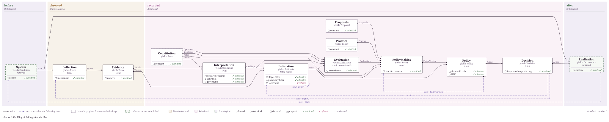

# kybernesis

*Steering a system known through evidence: the architecture of the loop from evidence to action declared as data and verified, blocks whose contracts methods must meet to be admitted, predefined methods formal and statistical, and the loop run.*

kybernesis (κυβέρνησις, steering, government) is a foundation library of [Noetarium, the Science and Humanity Infrastructure](https://github.com/huangwanhong-maker/Noetarium-The-Science-and-Humanity-Infrastructure). It began as the framework from evidence to action (the infrastructure's idea of 2026-11-18 and its ADR 0130). It names no object in nature: a city, a river basin, a court or a clinic are instances of it.

## 1. Concepts

**The architecture is data.** The loop from evidence to action is declared in a script, not written in code. The script has:

- registers, ordered by aboutness;
- the stages of one turn;
- the kinds of fact;
- the types that travel on wires;
- blocks with typed ports and laws;
- boundaries, through which the loop is given what it does not make;
- wires, some carried to the next turn.

The standard architecture ([architectures/standard.arch](architectures/standard.arch)) runs from evidence collection, through evidence, interpretation, estimation, evaluation, policy making, policy and decision, to the realised action. Anyone may revise it: add, remove or change a block, a law, a kind or a wire. A revision is admitted exactly when its checks pass.

**The checks are categorical and otherwise.** The constraints include:

- every block has what it emerged from and acts on something;
- every input is fed once and every output feeds something;
- wires join ports of one type;
- the wires within a turn form no cycle;
- a block yields a kind of its stage's register;
- no block yields an example;
- a wire going forward within a turn reaches only the next stage, or a later stage of its own register. So nothing in the record is computed from the system except through what is observed, and the system is reached only through what is decided.

kategoria answers the categorical claims, among them:

- the kinds form a thin category with Fact terminal;
- each kind lies in its register functorially;
- each block's stage is a functor from the step category to the stages: no wire runs back against the order of a turn.

The rule of the next stage is a property of paths and cannot be a functor's: a wire that skips a stage would be sent to the composite arrow, which exists. So it is a constraint, and the checks show both: such a wire is refused while the functor still holds.

**A method is admitted when it fits.** Any algorithm can fill a block, through an adapter that reads the block's inputs and writes its answer. It is admitted when two things hold on a finite instance of the architecture's types:

- its ports are the block's;
- the block's laws hold, decided by kategoria in a model in relations of the method's tabulation:
  - total;
  - deterministic;
  - sound: an estimator never loses the true state.

When a revision changes a block, the methods filling it are re-admitted (`carry`).

**Every conclusion is a dual verdict.** Its standing (clear, arguable or untenable over the admissible readings) and its measure (a probability, an interval, an estimate) are kept apart. A declared standard combines them. A proposal, a model's word, is never the record's.

## 2. Modules

| Module | Content | Status |
|---|---|---|
| [kernel](kernel/README.md) | dual verdicts and standards; scales and meaningfulness; doctrines on finite spaces and the naturality of the support | draft |
| [architecture](architecture/README.md) | the model; the language (BNF read by morphe) and its printer; the checks, constraints and categorical; revisions; the report | draft |
| [blocks](blocks/README.md) | values and instances; methods; admission, with the laws decided by kategoria; carrying methods over a revision | draft |
| [methods](methods/README.md) | adapters: constants, tables, mechanisms and the world's transitions; interpretation (declared, construal, precedents); estimation (possibilistic, Bayes, and a face-value counterexample); evaluation (exceedance under readings); policy (threshold, HSVI); an invented example | draft |
| [loop](loop/README.md) | the loop run on an instance, for any admitted architecture | draft |
| evolution | policy making as evolution with an honest protocol, on heuresis | planned |
| transfer | transfer between relational systems as a lens, valid when its square commutes within a tolerance | planned |
| constitution | versions of the schema, rules of change, records migrated by kategoria | planned |

The schema ([schema/framework.cat](schema/framework.cat)) states the kinds of fact, one step of the loop and the record as categories. kategoria answers its 42 statements, and the architecture's kinds include into the schema's fully and faithfully.

## 3. Dependencies

kategoria, tekmerion, tyche and apodeixis directly; morphe for the grammar; and through them peira, nomos, heuresis, kinesis, physis and calx.

## 4. Checks

86 checks in six programs: `check_kybernesis_kernel`, `_architecture`, `_schema`, `_blocks`, `_methods` and `_loop`. Inside the infrastructure, run them with `node development/tools/run-cpp.mjs foundations/kybernesis kybernesis`. Run with `--report`, `check_kybernesis_methods` prints the report that the visualization layer's computational graph reads ([docs/figures/standard-report.json](docs/figures/standard-report.json)).

## 5. Licence

MIT; see [LICENSE](LICENSE) and [CONTRIBUTORS.txt](CONTRIBUTORS.txt).
